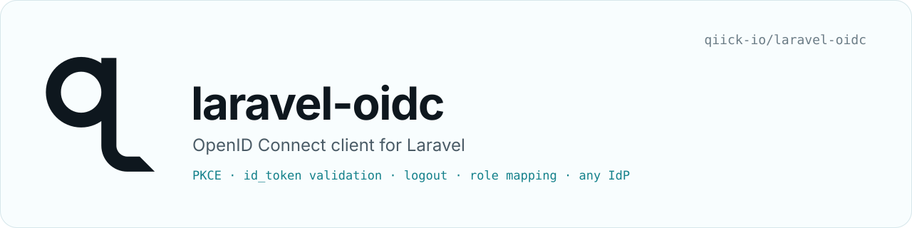

<p align="center">
  <picture>
    <source media="(prefers-color-scheme: dark)" srcset=".github/assets/header-dark.svg">
    <source media="(prefers-color-scheme: light)" srcset=".github/assets/header-light.svg">
    
  </picture>
</p>

# laravel-oidc

[](./LICENSE)
[](./composer.json)
[](./composer.json)

> **Status:** in development, not released. Nothing here is a stable contract yet.

`qiick/laravel-oidc` is an OpenID Connect client for Laravel apps: PKCE, `id_token` validation, logout, role mapping. It works with any standard identity provider: Keycloak, Zitadel, Authentik, Microsoft Entra ID, Google Workspace or Signaculum. It is the shared SSO login of the [qiick](https://qiick.io) apps and replaces the OIDC client that Externa and Excubia App each carry today.

SSO is optional. An app that installs the package keeps its local login (email and password, 2FA, passkeys), and SSO stays off until it is configured.

## Requirements

- PHP 8.3 or newer
- Laravel 12 or 13

## Installation

```bash
composer require qiick/laravel-oidc
php artisan vendor:publish --tag=oidc-config
```

## Configuration

Every key in `config/oidc.php` has an env var. They are defaults: an app can override them at runtime from its own settings (for example a settings table edited in an admin UI).

| Env var | Config key | Default | Meaning |
| --- | --- | --- | --- |
| `OIDC_ENABLED` | `oidc.enabled` | `false` | Turns the SSO login on. |
| `OIDC_ISSUER` | `oidc.issuer` | `null` | Issuer identifier, exactly as in the IdP's discovery document. |
| `OIDC_CLIENT_ID` | `oidc.client_id` | `null` | Client id registered at the IdP. |
| `OIDC_CLIENT_SECRET` | `oidc.client_secret` | `null` | Client secret; `null` for a public client (PKCE only). |
| `OIDC_BUTTON_LABEL` | `oidc.button_label` | `null` | Text of the SSO button on the login page. |
| `OIDC_JIT` | `oidc.jit` | `false` | Create a local user on the first SSO login. |
| `OIDC_AUTO_LINK` | `oidc.auto_link` | `false` | Link to an existing local user with the same verified email. Turn on only for a trusted IdP. |
| `OIDC_ONLY` | `oidc.only` | `false` | SSO-only mode: hide the password form; a break-glass local admin still works. |

## Protocol profile

What the package implements, from the accepted Signaculum SSO design (2026-11-05):

- **Flow:** authorization code with PKCE `S256` only, also for confidential clients. `state` and `nonce` on every login. No implicit flow, no password grant.
- **`id_token`:** signed `RS256` (`ES256` optional), validated on every login: signature through the JWKS (cached, refetched on an unknown `kid`), `iss`, `aud`, `exp`, `iat`, `nonce`, and `azp` when present.
- **Session:** after the callback the app keeps its own Laravel session, regenerated. Access and refresh tokens are not stored.
- **Logout:** RP-initiated logout (`end_session_endpoint`, `id_token_hint`, `post_logout_redirect_uri`) and back-channel logout (signed `logout_token`, matched by `sid` / `sub`). No front-channel logout.
- **Claims:** `sub`, `email`, `email_verified`, `name`, `preferred_username`, `picture`, `locale`, `amr` / `acr`. Provider-specific claims, such as an `orgs` claim for roles, are read through config, never hard-coded.
- **Identity key:** the pair (`issuer`, `sub`), stored in a `user_identities` table.

## Usage

> The routes, the user linking (`user_identities`) and the login itself land in the next pull requests. Today the package provides the protocol layer.

```php
use Qiick\Oidc\Services\AuthorizationCodeFlowService;

// GET /auth/oidc/redirect
public function redirect(Request $request, AuthorizationCodeFlowService $flow): RedirectResponse
{
    return $flow->redirect($request);
}

// GET /auth/oidc/callback
public function callback(Request $request, AuthorizationCodeFlowService $flow): RedirectResponse
{
    $identity = $flow->handleCallback($request); // throws an OidcException subclass on any failure

    // $identity->issuer, $identity->subject (the identity key), $identity->claims, $identity->sessionId
}
```

`redirect()` stores `state`, `nonce` and the PKCE verifier in the session and sends the browser to the IdP. `handleCallback()` accepts each `state` once, exchanges the code with the verifier and validates the `id_token`. Every failure throws a subclass of `Qiick\Oidc\Exceptions\OidcException` whose message is safe to log (no tokens, codes or secrets).

### Settings from the database

Externa and Excubia App keep their OIDC settings in a settings table. Bind your own repository after the package provider:

```php
$this->app->bind(ProviderConfigurationRepositoryContract::class, DatabaseOidcSettingsRepository::class);
```

### Advanced configuration

| Config key | Default | Meaning |
| --- | --- | --- |
| `oidc.redirect_uri` | `null` | `null` means `{APP_URL}/auth/oidc/callback`, the URI Externa and Excubia App already register. |
| `oidc.scopes` | `openid profile email` | `openid` is always sent. Add `qiick.orgs` for Signaculum's organisation claims. |
| `oidc.token_endpoint_auth_method` | `client_secret_basic` | Or `client_secret_post`. A client without secret is a public client. |
| `oidc.id_token.algorithms` | `['RS256']` | Accepted signing algorithms; only `RS*`, `PS256` and `ES*` can be enabled. |
| `oidc.id_token.leeway` | `60` | Clock skew in seconds. |
| `oidc.id_token.trusted_audiences` | `[]` | Extra `aud` values to accept; `azp` must then be the client id. |
| `oidc.cache.store` | `null` | Cache store for discovery and JWKS. |
| `oidc.cache.discovery_ttl` / `jwks_ttl` | `21600` / `3600` | Cache lifetimes in seconds. |
| `oidc.cache.jwks_refetch_cooldown` | `30` | Minimum seconds between JWKS refetches on an unknown `kid`. |
| `oidc.http.timeout` | `10` | Seconds per IdP request. |
| `oidc.http.discovery_base` (`OIDC_DISCOVERY_BASE`) | `null` | Docker: fetch discovery from this base instead of the issuer. |
| `oidc.http.server_origin` (`OIDC_SERVER_ORIGIN`) | `null` | Docker: scheme and host for the token, userinfo and JWKS calls. |
| `oidc.http.allow_private_hosts` (`OIDC_ALLOW_PRIVATE_HOSTS`) | `false` | Allow an IdP on a private network and plain http. Cloud metadata stays blocked. |

### Testing your app

The package ships an in-memory IdP, so app tests need no network:

```php
use Qiick\Oidc\Testing\FakeIdentityProvider;

$identityProvider = FakeIdentityProvider::fake(); // Http::fake() + config('oidc.*')
$authorizationUrl = $this->get('/auth/oidc/redirect')->headers->get('Location');
$callbackUrl = $identityProvider->authorize($authorizationUrl, ['sub' => 'user-42', 'email' => 'ada@example.com']);
$this->get($callbackUrl);
```

It checks the PKCE verifier, the code, the redirect URI and the client secret like a strict IdP, and signs `id_token`s with a key generated per test. `withDiscovery()`, `rotateSigningKey()`, `sign()` and `modifyTokenResponseUsing()` cover the failure cases.

## Development

```bash
composer install
composer test      # Pest + Testbench
composer lint      # Pint
composer analyse   # PHPStan, level max
```

Tests never use the network.

## Contributing and security

See [CONTRIBUTING.md](./CONTRIBUTING.md). Report vulnerabilities privately, as described in [SECURITY.md](./SECURITY.md).

## License

MIT. See [LICENSE](./LICENSE).
